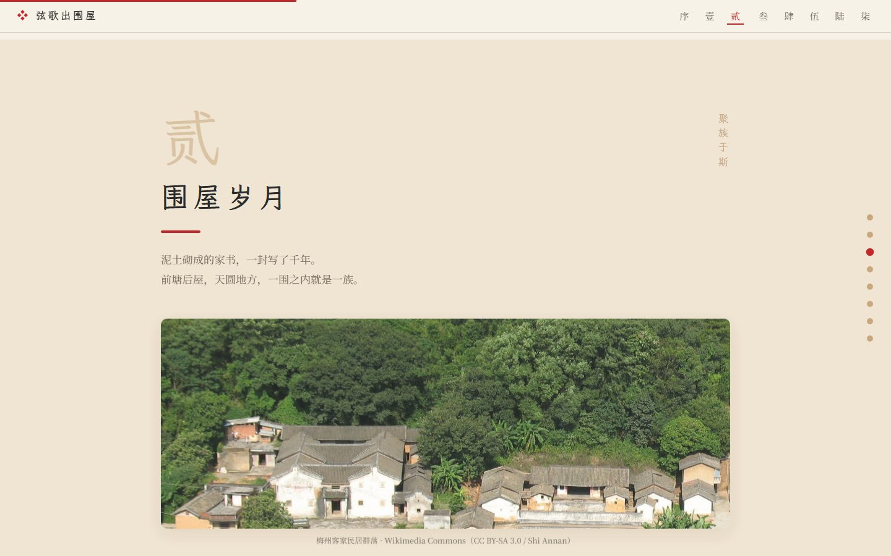
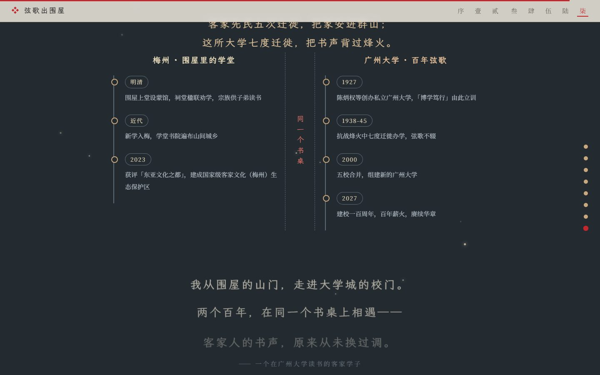

# 弦歌出围屋 · 从围屋到大学堂

> 世界客都 · 广东梅州 —— 一座城的千年书声，与一个学子的百年对话


一个讲客家人「把书声背进群山」的叙事型网页：从五次迁徙讲到围龙屋，从围屋的学堂讲到广州大学的七度迁徙，最后落回「一个在广州大学读书的客家学子」。

广州大学网页设计大赛 · 方向三 · 文化传承网页

---

## 在线体验

- **Cloudflare Pages**：<https://meizhou-site.pages.dev>
- **GitHub Pages**：<https://fengyuyouwu.github.io/meizhou-site/>
- **本地**：解压后**双击 `index.html`** 即可完整浏览——零依赖、无需联网、无需服务器。
- **本地服务器**（推荐，行为更接近线上）：

  ```bash
  cd meizhou-site
  python -m http.server 8000
  # 打开 http://localhost:8000
  ```

---

## 内容结构

序章 + 七章，全部第一人称推进：

| 章节 | 内容 | 主要交互 |
| --- | --- | --- |
| 序 · 客都印象 | 土楼群晨雾首屏 | 香火微尘粒子、滚动视差 |
| 水墨长卷 | 从围屋到远洋的横卷 | 滚动驱动横移、程序化 SVG |
| 壹 · 客从何来 | 客家五次迁徙 | ECharts 迁徙地图 × 阶段轮播双向联动 |
| 贰 · 围屋岁月 | 围龙屋形制与数据 | **围屋空间导览**（点五个部件看出处）+ 营造五步 |
| 叁 · 崇文重教 | 祖训与文教地标 | 祖训对开、东山书院 / 人境庐 |
| 肆 · 非遗之声 | 山歌 / 汉剧 / 埔寨火龙 | 童谣歌词卡、《月光光》音频 |
| 伍 · 客家烟火 | 一县一味 15 道美食 | 客家话小词典翻牌 |
| 陆 · 岁时节庆 | 烧火龙 / 上灯 / 过月半 / 天穿日 | 每节内嵌图片轮播、补天穿拖拽 |
| 柒 · 弦歌不辍 | 梅州 × 广大双时间轴 | 双列错落入场、留言板、名片工坊 |




---

## 技术要点

- **零构建、零依赖**：纯 HTML / CSS / JS；GSAP、ECharts、霞鹜文楷全部本地化，断网可跑。`assets/css/style.css` 由 `_tools/sync_css.py` 内联进 `index.html`，首屏没有阻塞渲染的外部样式请求。
- **字体工程**：霞鹜文楷（SIL OFL 1.1）按页面实际用字子集化，1231 字 + 标点符号合成两套字重各一个 woff2（regular 256KB / bold 253KB），首屏字体传输从 2.4MB 降到 510KB；字符集外的生僻字回退系统楷体。
- **滚动驱动入场**：`animation-timeline: view()` + `@supports` 渐进增强——不支持的浏览器内容直接可见，不靠 JS 也能读。
- **渐进增强三层**：GSAP / ECharts 动态加载失败 → 页面保持静态可读；系统开启「减少动效」→ 不加载动效库、不自动轮播；无 JS → 文本与图片仍在。
- **图片**：36 张背景图 `IntersectionObserver` 懒加载 + 渐显；首屏 AVIF 三档（640 / 1280 / 1920）；固定高度占位防布局漂移。
- **数据可视化**：ECharts geo 绘制四段迁徙路线，与轮播双向联动。

### 无障碍与适配

- 文本对比度按 WCAG AA（4.5:1 / 大字 3:1）逐屏校验过
- 可点区域 ≥24×24 CSS px（轮播点、章节导航用伪元素扩命中区，视觉尺寸不变）
- 全站 `:focus-visible` 焦点环；跳转链接（skip-link）
- `prefers-reduced-motion: reduce` 全链路生效（动效库不加载、轮播不自动翻页、数字直接给终值）
- 桌面 / 平板 / 手机三档断点，320px 无横向溢出

### 质量检查

用自建的确定性检查器 sloplint（17 条规则、真浏览器、三档视口）跑过：

```
floor   PASS   0 项    对比度 / 焦点 / 溢出 / 减少动效 / 资源 404 / 点击区 / fixed 定位
reflex  REVIEW 1 项    章号小标签重复（设计选择，已在报告中署名豁免）
finish  NOTE   若干    注释类小字 11.5–12.5px
```

---

## 数据与素材来源

页面内的每个统计数字都在页脚「数据与图片来源」中列了出处，包括：

- 围龙屋 4,367 座、名人故居 422 处、国家级传统村落 78 个、文保单位 499 处 —— 中国旅游报《守住客家根 自有客人来——广东梅州创建国家级文化生态保护区纪实》（[中国非物质文化遗产网](https://www.ihchina.cn/project_details/27373)，2023-05-25）
- 各级非遗代表性项目 420 项、代表性传承人 473 位（截至 2023 年初）—— 同上
- 国家级非遗 7 项 —— 中国非物质文化遗产网国家级项目名录、南方日报
- 「东亚文化之都 · 2023」—— 文化和旅游部评选名单
- 校史节点 1927 / 1938-45 / 2000 / 2027 —— 广州大学档案馆《广州大学简史》、学校官网《学校简介》、学校章程

图片共 40 张，全部来自 Wikimedia Commons 开放授权（CC0 / CC BY / CC BY-SA / 公有领域），逐张登记标题、作者、协议与来源链接：[assets/img/CREDITS.md](assets/img/CREDITS.md)。

个别暂无开放版权专拍的对象（埔寨火龙、部分菜式）使用同类场景图，并在页面中明确标注「示意」，不冒充实拍。

---

## 目录结构

```
meizhou-site/
├── index.html              # 单页入口
├── 作品简介.md              # 参赛作品说明
├── docs/                   # README 截图
└── assets/
    ├── css/                # 样式（含两个字体 @font-face）
    ├── js/                 # main / interactions / narrative / migration-map / ambient / loader
    ├── data/china-geo.js   # ECharts 地图数据
    ├── fonts/lxgw/         # 霞鹜文楷 woff2 子集（regular + bold 各一个文件）
    ├── img/                # 40 张图片 + CREDITS.md
    ├── audio/              # 《月光光》节选
    └── lib/                # gsap / ScrollTrigger / echarts
```

---

## 版权与授权

- **代码、文案、SVG 图解**：本作品原创，未经许可请勿商用。
- **图片**：Wikimedia Commons，按各自协议使用（多为 CC BY-SA，需署名），详见 `assets/img/CREDITS.md`。
- **字体**：霞鹜文楷，SIL Open Font License 1.1。
- **音频**：`assets/audio/yueguangguang.mp3` 为《新月光光》45 秒节选（演唱：钟雯），**仅用于本页非商业文化展示**，已注明演唱者；如需公开发布或商用，需另行取得词曲与录音授权。替换为自录或 CC 授权录音后可移除本条说明。
